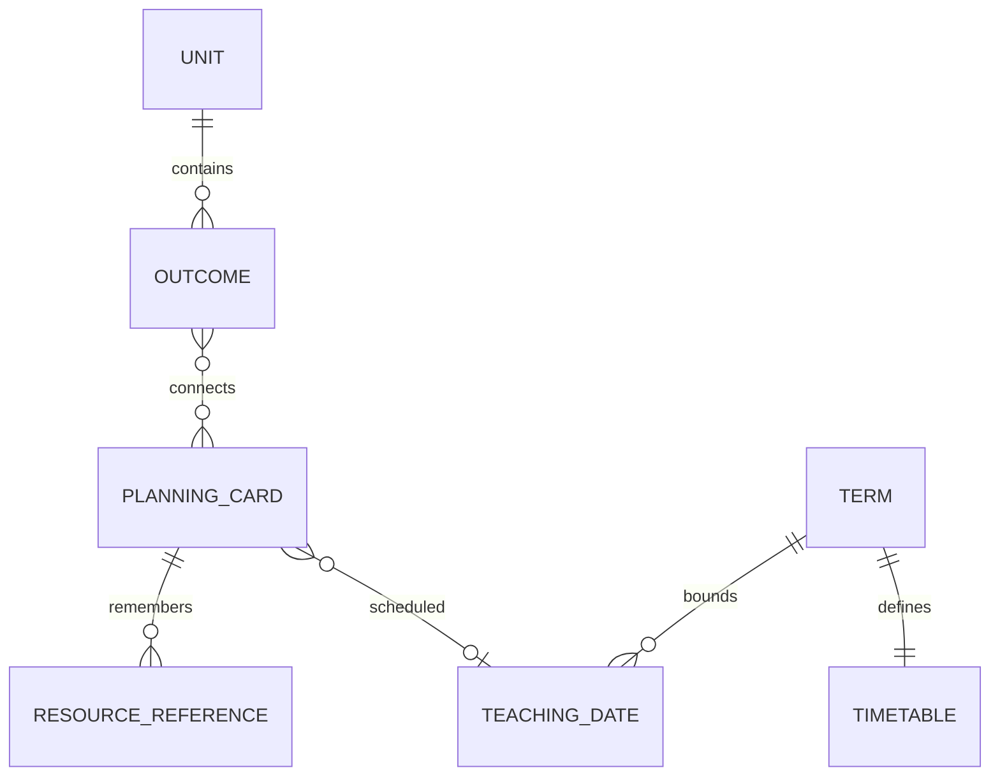

# Four Square product blueprint

## Working scope

The supplied conversation proposes a spacious, physical-card-inspired planning tool and a focused daily teaching view. The first prototype emphasizes curriculum cards, nested relationships, term planning, and instructional capacity. This implementation also makes simple resource references and a daily teaching view usable without remote integrations.

## Relationships

Units and outcomes have stable IDs. Each lesson stores outcome IDs; each view reads that one record. A card can connect across units without duplication. Removing an outcome detaches its connections while preserving lessons. Each card currently has one date, an integer number of periods, a subject, notes, assessment prompts, a current learning stage, and optional resource references. Multi-session cards and assessment history need a later data model.

Resources are references, not uploaded files. A Google Drive file ID is recognizable from supported URLs, but the current app opens the original URL and does not call Google APIs. Page/slide selections are notes. External URLs are restricted to http/https before rendering; resource text is rendered through React rather than injected HTML.

## Calendar and pacing

Term dates are inclusive. Capacity is the sum of a subject's Monday–Friday timetable slots on dates within the term, excluding entered days away. Minutes equal periods multiplied by the common period length. A zero-slot subject day is a valid teaching day with zero subject capacity; scheduling there raises a capacity warning rather than silently preventing a teacher's decision.

Weekend, excluded, and out-of-term dates cannot be newly assigned from the card editor or drop target. Changing a calendar preserves existing placements and flags affected cards. Day warnings compare each subject separately, so unused Language Arts time cannot hide a Science conflict. Term capacity describes the whole timetable, while scheduled totals show placed periods. Search filters can narrow displayed cards; term-wide capacity summaries remain explicit.

The teacher arranges progression. There is no automatic distribution or silent rescheduling.

## Local persistence

The version-1 JSON plan is stored under `four-square.plan.v1`. Import checks dates, bounds, IDs, references, subjects, statuses, periods, resources, and timetable shapes. Imports are limited to 2 MB and require confirmation before replacement. Existing corrupt storage is left intact; recovery download and explicit replacement are available. Storage errors are visible, and export remains available for the in-memory plan.

No backend or authentication is needed for this prototype. React, TypeScript, and Vite provide a small, static-deployable application with testable pure model functions. The data model can later move behind a service without duplicating the card relationships. A production multi-user version should add authenticated server persistence, ownership and authorization, migrations, backups, privacy controls, and conflict handling before enabling sharing.

## Implemented workflows

- Subject colours accompanied by text labels; unit stacks; expandable outcome stacks.
- Create, edit, and remove curriculum and lesson cards, including multiple outcome connections.
- Weekly drag scheduling plus explicit date inputs for keyboard and touch use.
- Term-level instructional capacity and weekly subject warnings.
- Learning stages: planned, taught, practised, assessed. Coverage shows recorded card stages, not a claim that an outcome has been mastered.
- Teaching Mode with lesson notes, assessment prompts, and original resource links.
- Browser-local persistence, backup export/import, and recovery protection.
- Responsive layouts, native modal focus management, labelled controls, and reduced-motion support.

## Later phases

1. **Teacher validation:** test card relationships, useful density, accessible contrast, pacing assumptions, and teaching focus with teachers. Replace sample wording with verified Alberta curriculum. Add grades, subjects, multiple terms/classes, monthly views, and richer tabletop positioning only as validated.
2. **Drive references:** add minimum-scope Google OAuth and Picker, verify access, retain file identity when moved within Drive, and surface deleted or inaccessible references. Preserve original organization and a usable disconnected experience.
3. **Preparation:** with explicit teacher approval, temporarily process selected PDF pages into Print Packs and show a printing checklist. Do not silently alter originals; address permissions and copyright in the real integration design.
4. **Daily presentations:** build slides from teacher-approved plans with preview and editing.
5. **Resource processing and partnerships:** explore worksheet recognition, suggested outcome links, and TPT/publisher integration after the underlying workflow is validated. Suggestions remain teacher-approved.

## Verification

Model tests cover capacity, dates, shared records, coverage, import validation, safe links, and curriculum removal. Chromium tests exercise edits across views, drag/drop, calendar conflicts, curriculum creation, persistence/recovery, and mobile layout. These checks validate the prototype's supported workflow, not Google integration, official curriculum accuracy, or real classroom effectiveness.
